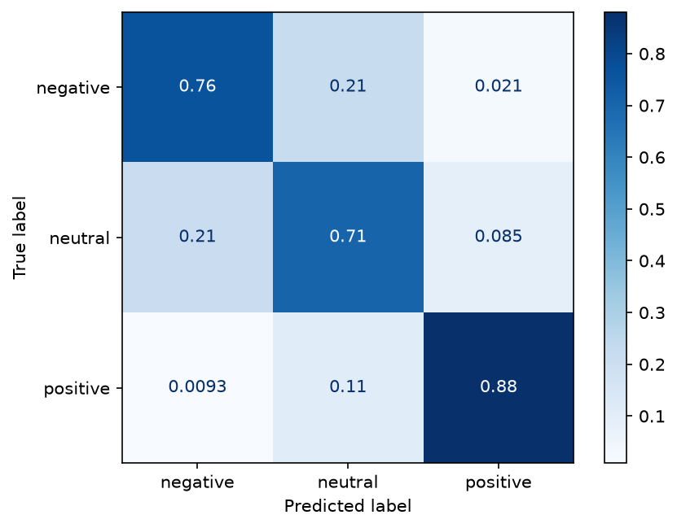

# Тональность отзывов на русском (ruBERT)

Классификатор тональности русскоязычных отзывов: **негатив / нейтрально / позитив**.
Дообученный [`cointegrated/rubert-tiny2`](https://huggingface.co/cointegrated/rubert-tiny2) на отзывах с Яндекс Карт + веб-демо на Gradio.


## Результаты

Тестовая выборка: 3 600 реальных отзывов, классы сбалансированы.

| Модель | Macro-F1 | Accuracy |
|---|---|---|
| TF-IDF (1–2-граммы) + логистическая регрессия | 0.756 | — |
| rubert-tiny2 v1 (только реальные отзывы) | 0.784 | 0.783 |
| **rubert-tiny2 v2 (+ синтетика на сарказм и отрицания)** | **0.784** | **0.783** |

```
              precision    recall  f1-score   support      (v2)
    negative     0.7806    0.7639    0.7722      1220
     neutral     0.6834    0.7056    0.6943      1199
    positive     0.8904    0.8806    0.8855      1181
```



**Что видно по ошибкам.** Модель почти не путает позитив с негативом (≈2%). Основные ошибки — на границе с «нейтрально»: отзыв на 3★ обычно смешанный («номер чистый, но шумно»), а автор отзыва на 2★ или 4★ часто пишет так же. Это шум в самой разметке «по звёздам», а не только слабость модели.

## Стресс-тест в искусственных условиях

`python stress_test.py [папка_модели]` → отчёт в [reports/stress_test.md](reports/stress_test.md) (v2) и [reports/stress_test_v1.md](reports/stress_test_v1.md) (v1).

Первый стресс-тест показал, что v1 не понимает сарказм (0/3) и отрицания (1/4): она реагирует на отдельные слова «спасибо», «супер», «не», а не на смысл. Чтобы это исправить, [augment.py](augment.py) генерирует по шаблонам 868 отзывов (~3% обучающей выборки):

- **сарказм** — позитивная обёртка + плохой факт: «Ставлю лайк за мокрые полотенца» → негатив;
- **искренние пары** — те же обёртки + хороший факт: «Какая прелесть, курьер поднял пакеты до двери» → позитив. Без них модель просто выучила бы «спасибо = негатив»;
- **отрицания** в обе стороны: «Ни одного замечания, в номере было тепло и чисто» → позитив, «Ни уютно, ни тихо — мимо» → негатив.

Шаблоны и слова-заполнители разделены 70/30: отложенная часть в обучение не попадает и служит отдельным тестом. Плюс второй рукописный набор из 23 фраз, написанный в других формулировках и тоже не участвующий в обучении.

| Проверка | v1 | v2 |
|---|---|---|
| Реальные отзывы, macro-F1 | 0.784 | 0.784 |
| Первые 25 сложных отзывов | 17/25 | **21/25** |
| **Новый рукописный набор** (сарказм/отрицания, не в обучении) | 6/23 | **12/23** |
| Отложенные шаблоны (не в обучении) | 57/141 | **92/141** |
| ↳ отрицание → позитив | 1/18 | 14/18 |
| ↳ сарказм | 11/42 | 22/42 |

**Итог:** на новых фразах про сарказм и отрицания модель стала права вдвое чаще, а качество на обычных отзывах не просело. Но задача не решена: v2 ошибается примерно в половине новых случаев, особенно когда сарказм без явных маркеров («Чудесный отель, особенно плесень в душе — придаёт шарм» → позитив). Появились и регрессии: «Браво шеф-повару, давно не ели такой сочный стейк» и «Пойдёт.» теперь уходят в негатив. Шаблонная синтетика учит конструкциям, а не пониманию — для настоящего прорыва нужна модель крупнее и живые размеченные примеры сарказма.

**Устойчивость к шуму** (v2, 600 реальных отзывов, accuracy 0.778 без искажений):

| Искажение | Accuracy | Ответ изменился |
|---|---|---|
| нижний регистр | 0.753 | 7.7% |
| без пунктуации | 0.772 | 6.3% |
| −30% слов | 0.740 | 13.0% |
| только первые 10 слов | 0.628 | 26.3% |
| опечатки в 10% букв | 0.618 | 25.3% |

**Граничные входы** (эмодзи, `5/5`, HTML, одна буква, 3 200 символов) — ничего не падает. На пустых по смыслу входах модель честно не уверена (≈0.4–0.5), но HTML-мусор стоит чистить до подачи в модель.

**Скорость:** ~3 мс на отзыв, ~400 отзывов/с пачкой (Apple M3, MPS).

## Эксперименты v3 (в процессе)

Шаблонные тесты писал тот же автор, что и шаблоны, поэтому [mine_hard.py](mine_hard.py) собирает **реальные сложные отзывы** из той части датасета, что не попала в основную выборку: 1–2★ с хвалебными словами («магазин отличный, но кассир…») и 4–5★ с отрицаниями («ни разу не пожалели»). Получилось 2 316 отзывов, они поровну разбиты на негатив и позитив и разделены на три части: train 926 (идёт в обучение), dev 462 (по нему выбираем модель) и test 928 (открывается один раз, в самом конце).

Сравнение — `python evaluate.py model_dir ...`, журнал в [experiments.jsonl](experiments.jsonl):

| Модель | F1 реальные | hard-dev негатив | hard-dev позитив | hard-dev среднее | новые 23 фразы |
|---|---|---|---|---|---|
| v1 | 0.784 | 0.584 | 0.853 | 0.718 | 6 |
| v2 (+ шаблоны) | 0.784 | 0.584 | 0.896 | 0.740 | 12 |
| v3a (+ шаблоны + реальные сложные) | 0.780 | **0.649** | **0.900** | **0.774** | 12 |
| v3b ruBert-base | прервано после 1 эпохи из 2, val F1 0.794 (у tiny ≈0.78) | | | | |

Вывод на сейчас: шаблоны улучшили ответы на шаблонных фразах, но не на реальном сложном негативе (0.584 → 0.584). Реальные сложные примеры дали +6.5 п. Крупная модель на Apple M3 не помещается в память при 256 токенах; обучение перенесено на GPU.

### Запуск на GPU

Код сам выберет CUDA, ничего менять не нужно.

```bash
pip install -r requirements.txt
python mine_hard.py                          # data/hard_*.jsonl, детерминированно
python train.py --augment --hard --out model_v3a
python train.py --augment --hard --base-model ai-forever/ruBert-base --out model_v3b
python evaluate.py model_v3a model_v3b       # по dev; --hard test — только для финальной модели
```

Продолжить прерванный прогон: те же флаги + `--resume checkpoints/<out>/checkpoint-N` (для v3b с Mac: `--max-length 128 --batch 16 --epochs 2`).

## Данные

[`d0rj/geo-reviews-dataset-2023`](https://huggingface.co/datasets/d0rj/geo-reviews-dataset-2023) — 500 000 отзывов об организациях с Яндекс Карт (MIT).

- Разметка по рейтингу: 1–2★ → негатив, 3★ → нейтрально, 4–5★ → позитив.
- Исходно 86% отзывов позитивные, поэтому взято по 12 000 на класс (36 000 всего).
- Разбиение 80 / 10 / 10 (train / val / test), `seed=42`.

## Обучение

- `max_length=256`, batch 32, lr 5e-5, warmup 6%, weight decay 0.01, 3 эпохи.
- Лучший чекпоинт выбирается по macro-F1 на валидации.
- ~14 минут на Apple M3 (MPS), модель 29M параметров, 114 МБ.

## Запуск

```bash
python -m venv .venv && source .venv/bin/activate
pip install -r requirements.txt

python train.py --augment  # скачает датасет, обучит бейзлайн и модель v2 → ./model, ./reports
python app.py            # веб-демо на http://127.0.0.1:7860
pytest -q                # смоук-тесты модели
```

Флаги `train.py`: `--per-class` (сколько отзывов на класс), `--epochs`, `--out`, `--augment` (синтетика на сарказм и отрицания; без него — v1).
`app.py` читает модель из `MODEL_PATH` (локальная папка или id на Hugging Face Hub).

## Структура

```
train.py        данные → бейзлайн → fine-tune → метрики и графики
app.py          Gradio-интерфейс
test_app.py     тесты
augment.py      шаблонная синтетика: сарказм и отрицания
mine_hard.py    реальные сложные отзывы → data/hard_{train,dev,test}.jsonl
evaluate.py     сводная оценка моделей (F1, hard-dev, рукописные наборы)
stress_test.py  стресс-тест: сарказм, отрицания, шум, граничные входы, скорость
reports/        метрики, отчёт, матрица ошибок, скриншот
```

## Что можно улучшить

- Взять `ai-forever/ruBert-base` вместо tiny-версии (медленнее в ~10 раз, ожидаемо +2–4 п. F1).
- Разметить «нейтрально» вручную вместо звёзд — главный источник ошибок.
- Выложить веса на Hugging Face Hub и демо на HF Spaces.
