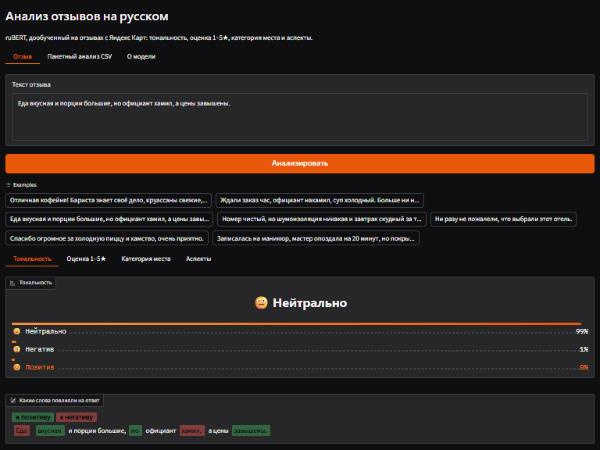
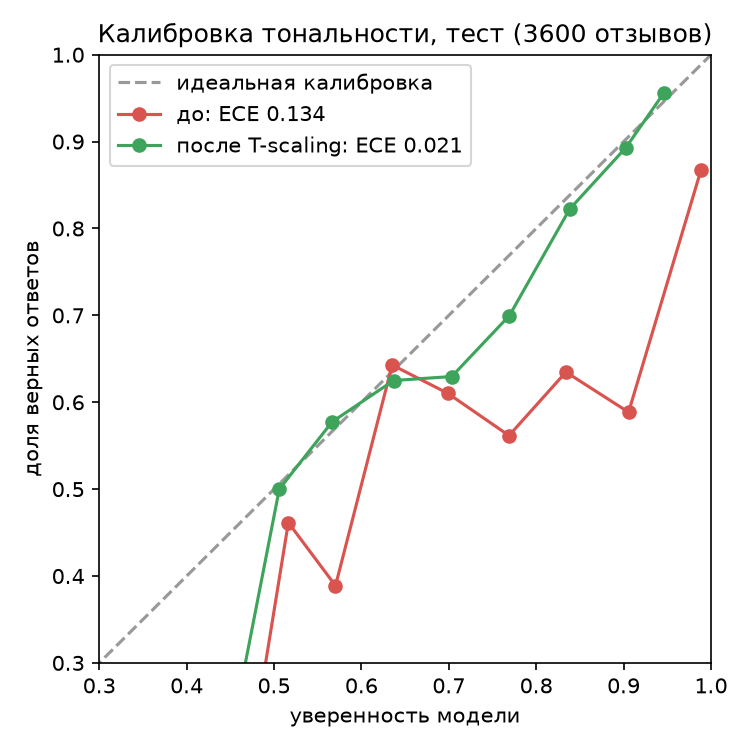

# Анализ отзывов на русском: тональность, оценка 1–5★, категория, аспекты

Одна multi-task модель на базе [`ai-forever/ruRoberta-large`](https://huggingface.co/ai-forever/ruRoberta-large), дообученная на 36 000 отзывах с Яндекс Карт. По тексту отзыва она определяет:

- **тональность**: негатив / нейтрально / позитив, плюс подсветку слов, которые повлияли на ответ;
- **точную оценку 1–5★**, которую поставил автор;
- **категорию места**: топ-15 рубрик Яндекс Карт («Гостиница», «Ресторан», «Салон красоты»…) и «другое»;
- **аспекты**: «еда — позитив, персонал — негатив» (фразы отзыва + словарь аспектов + тональность каждой фразы, без новой разметки).

Ещё в проекте: веб-демо (Gradio) с вкладками под каждое умение, пакетный анализ CSV со сводкой жалоб, REST API (FastAPI), Docker, ONNX int8 для CPU, калиброванные вероятности, внешний тест на рецензиях Кинопоиска и **дистиллированная ruBert-base модель**: то же качество, вдвое меньше и в 4–10 раз быстрее (см. [Дистилляция](#дистилляция-large--base)).



## Главное в цифрах

Все числа — на отложенном тесте, который в обучении не участвовал.

| Умение | Модель | Бейзлайн TF-IDF + LogReg |
|---|---|---|
| Тональность, macro-F1 (3 600 реальных отзывов) | **0.820** | 0.756 |
| Тональность на сложных отзывах (hard-test, 928 шт.) | **0.835** | — (v1: 0.720) |
| Оценка 1–5★: accuracy / macro-F1 | **0.750 / 0.553** | 0.714 / 0.471 |
| Оценка 1–5★: средняя ошибка (MAE) / доля с ошибкой ≤ 1★ | **0.35★ / 90.6%** | 0.48★ / 82.6% |
| Категория (16 классов): accuracy / macro-F1 / top-3 | **0.753 / 0.605 / 95.2%** | 0.700 / 0.404 / 93.4% |
| Аспекты: тональность фразы на смешанных отзывах / согласие с 5★ и 1★ | 81% / 92% / 73% | — |
| Вне домена: рецензии на фильмы с Кинопоиска, macro-F1 (3 000 шт.) | **0.640** | 0.404 (v1: 0.477) |
| Калибровка: ECE до / после temperature scaling | 0.134 → **0.021** | — |

## Как модель росла

| Версия | Что изменилось | F1 реальные | hard-dev | новые 23 фразы |
|---|---|---|---|---|
| v1 | rubert-tiny2 (29M), только реальные отзывы | 0.782 | 0.716 | 6 |
| v2 | + 868 шаблонных отзывов с сарказмом и отрицаниями | 0.782 | 0.727 | 13 |
| v3a | + 926 реальных «сложных» отзывов | 0.777 | 0.766 | 12 |
| v3b | ruBert-base (178M) | 0.797 | 0.786 | 18 |
| v3c | rubert-base, уже обученный на тональность | 0.787 | 0.777 | 13 |
| v3d | ruRoberta-large (355M) | 0.813 | 0.811 | 17 |
| **multi** | v3d + головы 1–5★ и категории, обучены совместно | **0.820** | **0.814** | **18** |

*hard-dev* — реальные отзывы, где слова противоречат оценке: 1–2★ с похвалой («магазин отличный, но кассир…») и 4–5★ с отрицаниями («ни разу не пожалели»). Их собирает [mine_hard.py](mine_hard.py) из части датасета вне основной выборки. По dev выбирали модель, test открыли **один раз** в самом конце.

**Шум по seed.** Каждую из двух лучших архитектур обучили ещё дважды с другими seed:

| Семейство | прогонов | F1 реальные | hard-dev |
|---|---|---|---|
| ruRoberta-large (v3d) | 3 | 0.820 ± 0.007 | 0.809 ± 0.012 |
| ruBert-base (v3b) | 3 | 0.802 ± 0.004 | 0.784 ± 0.005 |
| multi-task на v3d | 1 | 0.820 | 0.814 |

Отрыв large от base (+0.025 hard-dev) больше разброса по seed, значит, это реальное улучшение. Multi-task модель по тональности не хуже v3d, разница в пределах шума, при этом она умеет ещё два дела. Поэтому финальная модель — multi.

**Финальный hard-test** (928 отзывов, открыт один раз, [final_test.jsonl](final_test.jsonl)):

| Модель | F1 реальные | hard-test негатив | hard-test позитив | среднее |
|---|---|---|---|---|
| v1 | 0.782 | 0.593 | 0.847 | 0.720 |
| v2 | 0.782 | 0.550 | 0.871 | 0.711 |
| **multi** | **0.820** | **0.716** | **0.955** | **0.835** |

На тесте результаты совпадают с dev (0.835 против 0.814), значит, выбор модели под dev не переобучен.

## Новые умения

### Оценка 1–5★ и категория места: multi-task

[train_multi.py](train_multi.py): общий энкодер и три головы (тональность, 5 звёзд, 16 категорий), сумма трёх cross-entropy. Синтетические и «сложные» отзывы размечены только по тональности, для них лосс звёзд и категории маскируется. Обучение — простой цикл PyTorch (AdamW, warmup, fp16), без `Trainer`. Новые головы учатся с lr 1e-3, энкодер — с 1e-5. Модель сохраняется в стандартном формате `AutoModelForSequenceClassification`, так что `pipeline` и [evaluate.py](evaluate.py) работают как раньше. Головы звёзд и категории лежат рядом в `heads.pt`.

Данные — тот же сплит, что для тональности (поля `rating` и `rubrics` датасета, [tasks.py](tasks.py)). Категория — первая рубрика места, топ-15 по частоте плюс «другое». Бейзлайны TF-IDF + LogReg — в [baselines.py](baselines.py).

- **1–5★.** Модель ошибается в среднем на 0.35★, в 90.6% случаев ошибка не больше одной звезды. Macro-F1 скромный (0.55): 2★ и 4★ редкие, в тесте их 302 и 103 из 3 600, и по тексту их трудно отличить от 1★ и 5★.
- **Категория.** «Другое» — это 54% отзывов, а «Кафе», «Ресторан», «Бар» и «Кофейня» по тексту похожи, поэтому точная категория угадывается в 75% случаев. В top-3 правильная категория попадает в 95% случаев.

### Аспекты

[sentiment.py](sentiment.py): отзыв режется на фразы (предложения, «…, но …», запятые), в каждой фразе по словарю ищутся аспекты (10 штук: персонал, еда и напитки, цены, чистота, атмосфера, скорость и ожидание, расположение, доставка, проживание, товар и ассортимент), а тональность фразы определяет модель.

Короткие фразы модель склонна считать нейтральными: её учили, что 3★ — это нейтрально, и на «суп остыл» она даёт P(нейтр.) = 0.84. Поэтому знак фразы берётся из полярности (P(поз) − P(нег)) / (P(поз) + P(нег)) без массы «нейтрально». Это подняло точность на смешанных отзывах с 0.58 до 0.72, а согласие с 1★ на реальных отзывах — с 0.68 до 0.75. Правило подбиралось на рукописном наборе, так что независимая проверка — прокси на реальных отзывах.

Разметки аспектов в датасете нет, поэтому две проверки ([aspect_eval.py](aspect_eval.py), [reports/aspects.json](reports/aspects.json)):

| Проверка | Результат |
|---|---|
| **Рукописные смешанные отзывы** (20 шт., ожидаемые аспекты и их тональность) | аспекты найдены: precision 0.95, recall 0.95; тональность аспекта верна в **81%** |
| **Реальные 5★** (100 отзывов из теста): упоминания аспектов с позитивной тональностью | **92%** (негативных 4%) |
| **Реальные 1★** (100 отзывов): упоминания с негативной тональностью | **73%** (позитивных 18%; в 1★-отзывах часто хвалят что-то одно) |
| **Реальные 3★** (100 отзывов): отзывы, где есть и похвала, и жалоба | 53% |
| Доля отзывов, где найден хотя бы один аспект | 90–92% |

Пример: «Еда вкусная, но официант нахамил.» → Еда и напитки: позитив (+0.94), Персонал: негатив (−0.94).

В пакетном режиме упоминания складываются в **топ жалоб**: аспект, сколько раз его ругали и хвалили, и самый негативный пример.

## Анализ ошибок

Полный отчёт: [reports/error_analysis.md](reports/error_analysis.md) ([error_analysis.py](error_analysis.py)). Для каждой ошибки — слова, которые повлияли на ответ (Integrated Gradients, подробности ниже). То же самое показывает вкладка «Тональность» в демо.

| Истина \ Модель | Негатив | Нейтрально | Позитив |
|---|---|---|---|
| Негатив | 975 | 226 | 19 |
| Нейтрально | 245 | 880 | 74 |
| Позитив | 4 | 83 | 1094 |

- **Грубых ошибок (негатив ↔ позитив) 0.6%** (23 из 3 600). Остальные 96% ошибок — на границе с «нейтрально», в основном 2★ ↔ 3★: их и люди пишут одинаково.
- **Самые уверенные «ошибки» — шум в разметке.** «Делала коррекцию бровей, большое спасибо, очень понравилось» стоит с 1–2★. Модель права, а звёзды — нет (кто-то промахнулся по оценке или ставит низкую за что-то вне текста).
- **По срезам:** отзывы со словами «нормально / неплохо / так себе» — 24% ошибок, смешанные «…, но …» — 22%, с отрицаниями — 21%, с похвалой — всего 11% (реальные «сложные» отзывы в обучении сделали своё дело).
- **Сарказм без маркеров** («Какой сервис! Мне даже разрешили самому убрать за собой стол») пока не решён: 3 из 8 в рукописном наборе. Модель видит «Какой сервис!» и не понимает, что «самому убрать» — плохо. Нужны живые размеченные примеры сарказма.
- **Длинные отзывы со списком плюсов и минусов** (hard-dev: «Из плюсов: отличные сотрудники… А вот остальное: сантехника убита…») — модель взвешивает плюсы и минусы примерно поровну, а автор поставил 1–2★. Здесь помогает вкладка «Аспекты»: в ней видно, что именно ругают.
- **Как считаются веса слов.** Сначала была окклюзия: убрать слово и посмотреть, как изменится P(поз) − P(нег). На уверенной large-модели это шум: при P = 0.99 удаление одного слова почти ничего не меняет, а при избыточных признаках («очень вкусная еда и приятный персонал») «вкусная» даже получала знак минус. Сейчас используется **Integrated Gradients**: градиент разницы логитов позитив − негатив по эмбеддингам на пути от «пустого» входа (все слова → `<pad>`) к реальному тексту. Веса субтокенов суммируются в слова. Считаются первые 128 токенов за 16 шагов: 0.1 с на короткий отзыв и 0.7 с на длинный (GPU).

## Стресс-тест

`python stress_test.py model` → [reports/stress_test.md](reports/stress_test.md). Сравнение с v2 — [reports/stress_test_v1.md](reports/stress_test_v1.md) и история выше.

| Проверка | v1 | v2 | **финальная** |
|---|---|---|---|
| Первые 25 сложных отзывов | 17–18 | 20–21 | **22** |
| Новые 23 фразы (сарказм/отрицания, в обучении нет) | 6 | 12–13 | **18** |
| ↳ отрицания (12) | — | — | **12/12** |
| ↳ сарказм (8) | — | — | 3/8 |
| Отложенные шаблоны (141) | 52–57 | 92–94 | **135** |

**Устойчивость к шуму** (600 реальных отзывов):

| Искажение | v2 (tiny) | v3b (base) | **финальная** (large) | ответ изменился | ученик (base, дистилляция) |
|---|---|---|---|---|---|
| нет | 0.778 | 0.803 | **0.823** | — | 0.827 |
| нижний регистр | 0.753 | 0.803 | **0.812** | 3.7% | 0.827 |
| без пунктуации | 0.772 | 0.792 | **0.808** | 7.2% | 0.807 |
| опечатки в 10% букв | 0.618 | 0.735 | **0.770** | 15.8% | **0.782** |
| −30% слов | 0.740 | 0.767 | **0.770** | 12.8% | 0.797 |
| только первые 10 слов | 0.628 | 0.657 | **0.658** | 27.8% | 0.685 |

Опечатки были самым слабым местом tiny-модели (0.618). Крупная модель держит их лучше (0.770), а ученик, которого учили с опечатками в 15% примеров, — ещё лучше (0.782). Опечатки в обучении — смесь перестановок, пропусков, удвоений и соседних клавиш ([augment.typos](augment.py)), а в тесте — только перестановки соседних букв.

Граничные входы (эмодзи, `5/5`, HTML, одна буква, 3 200 символов) не ломают модель, HTML вычищается до подачи в модель. Ошибки остались: «ЛУЧШЕЕ МЕСТО В ГОРОДЕ!!!!!!» → негатив (капс + восклицания в датасете чаще у злых отзывов), «Пойдёт.» → позитив.

## Внешний тест: рецензии на фильмы

Все модели учились только на отзывах о местах с Яндекс Карт. Чтобы проверить, работает ли модель за их пределами, её без дообучения прогнали на [`blinoff/kinopoisk`](https://huggingface.co/datasets/blinoff/kinopoisk) (рецензии на фильмы, MIT): по 1 000 рецензий на класс. Другой домен, другой стиль, и рецензии длинные (медиана 1 600 символов) — длиннее окна модели в 256 токенов. Поэтому оценены два чтения: начало рецензии (как в демо) и последние 150 слов (вердикт обычно в конце). `python kinopoisk_eval.py model model_v1` → [reports/kinopoisk.md](reports/kinopoisk.md).

| Модель | F1 (начало) | F1 (конец) | recall нег / нейтр / поз (конец) |
|---|---|---|---|
| TF-IDF + LogReg | 0.400 | 0.404 | 0.54 / 0.61 / 0.15 |
| v1 (tiny) | 0.459 | 0.477 | 0.77 / 0.44 / 0.28 |
| v3b (base) | 0.595 | 0.602 | 0.53 / 0.51 / 0.76 |
| ученик (base, дистилляция) | 0.602 | 0.622 | 0.63 / 0.44 / 0.81 |
| **финальная (large)** | **0.629** | **0.640** | 0.63 / 0.48 / 0.83 |

Качество вне домена ниже, чем на Яндекс Картах (0.64 против 0.82), — это ожидаемо. Но разрыв между моделями здесь гораздо больше, чем в домене: TF-IDF и tiny-модель выучили «словарь заведений» и на фильмах почти угадывают (у v1 позитив распознан в 28% случаев), а large-модель понимает тональность в целом. Грубых ошибок мало: негативную рецензию финальная модель назвала позитивной в 2% случаев. Почти все ошибки — на границе с «нейтрально», которое на Кинопоиске означает «фильм средний», а не «смешанный отзыв».

## Калибровка вероятностей

Значит ли «уверенность 0.9», что модель права в 9 случаях из 10? Нет: дообученная модель самоуверенна. Средняя уверенность — 0.95 при точности 0.82, ECE (средний разрыв между уверенностью и долей верных ответов по 15 корзинам) — **0.134**. Температура T подобрана на val по минимуму NLL ([calibrate.py](calibrate.py)) и проверена на тесте:

| | ECE | NLL | средняя уверенность | accuracy |
|---|---|---|---|---|
| финальная, как есть | 0.134 | 0.692 | 0.953 | 0.819 |
| **финальная, T = 2.16** | **0.021** | **0.486** | 0.836 | 0.819 |
| ученик, как есть | 0.119 | 0.614 | 0.941 | 0.823 |
| **ученик, T = 2.00** | **0.029** | **0.462** | 0.838 | 0.823 |



Температура лежит в `MODEL/reports/calibration.json`, и `Analyzer.predict` и пакетный анализ показывают уже откалиброванную уверенность: метка не меняется, но «0.84» теперь действительно значит около 84%. Предупреждение «модель не уверена» в демо стало честным. Аспекты считаются по исходным вероятностям: их порог подобран под них.

## Дистилляция: large → base

ruRoberta-large точна, но тяжела: 1.4 ГБ и 72 мс на отзыв на CPU даже в ONNX. [distill.py](distill.py) переносит её знания в ruBert-base с теми же тремя головами:

1. **Псевдоразметка.** 100 000 отзывов с Яндекс Карт, которых нет ни в одном нашем наборе (train/val/test, hard-*), с выборкой по рейтингу, чтобы негатив не утонул в 5★: взяты все свободные 1–2★ (33 тыс.) и 3★ (9.7 тыс.), остальное — 4–5★ (57 тыс.). Рейтинг нужен только для выборки, цели — вероятности учителя для тональности, 1–5★ и категории. Учитель разметил 130 тыс. текстов (вместе с обычным train) за 4 минуты.
2. **Обучение ученика** (инициализация — v3b): кросс-энтропия к смягчённому распределению учителя (T = 2, × T²) для всех трёх голов, 2 эпохи, 23 мин на RX 7900 GRE. В 15% примеров вставлены опечатки, а цель остаётся от чистого текста.
3. **Отбор** по реальным меткам val, hard-test ученика открыт **один раз** в конце.

| | v3b (base) | **ученик (base)** | учитель (large) |
|---|---|---|---|
| Тональность, F1 (тест) | 0.797 | **0.823** | 0.820 |
| hard-dev / hard-test | 0.786 / — | **0.814 / 0.832** | 0.814 / 0.835 |
| Опечатки 10% | 0.735 | **0.782** | 0.770 |
| Кинопоиск, F1 (конец) | 0.602 | 0.622 | **0.640** |
| Новые 23 фразы / первые 25 | 18 / — | 16 / 24 | 18 / 22 |
| 1–5★: MAE / ≤ 1★ | — | 0.356 / 89.7% | **0.353 / 90.6%** |
| Категория: acc / top-3 | — | 0.752 / 95.4% | 0.753 / 95.2% |
| Параметры / веса | 178M / 681 МБ | **178M / 681 МБ** | 355M / 1.4 ГБ |
| GPU: мс на отзыв / отзывов/с (пачка) | 6.6 / 66 | **6.7 / 66** | 17.5 / 15 |
| CPU, ONNX fp32: мс на отзыв | — | **14.6** | 72 |
| CPU, ONNX int8: мс на отзыв / размер | — | **7.4 / 171 МБ** | 29 / 341 МБ |
| ONNX int8: F1 / hard-dev | — | **0.823 / 0.807** | 0.810 / 0.805 |

Ученик догнал учителя на Яндекс Картах (в пределах разброса по seed) и обогнал на опечатках. Чуть уступает вне домена (−0.02 на Кинопоиске) и на рукописных фразах с сарказмом. При этом он в 2.6 раза быстрее на GPU, в 5 раз быстрее на CPU, а его int8-версия в **10 раз быстрее и в 8 раз меньше** учителя в ONNX fp32 (в 4 и 2 раза — против int8-учителя), и int8 у него почти не теряет качества (F1 0.823 против 0.810 у int8-учителя). Для бесплатного CPU-хостинга (Hugging Face Space) это лучший вариант.

## Скорость и ONNX

`python export_onnx.py model onnx` экспортирует все три головы в ONNX, квантует веса в int8 (`onnxruntime.quantization.quantize_dynamic`) и замеряет скорость на CPU (8 потоков, один отзыв, 300 реальных отзывов из теста; [reports/onnx_report.json](reports/onnx_report.json)):

| Вариант | мс на отзыв | отзывов/с (пачка 32) | размер | ответы совпадают с PyTorch |
|---|---|---|---|---|
| PyTorch fp32 | 1918* | <1 | 1.4 ГБ | — |
| ONNX fp32 | 72 | 5 | 1356 МБ | 100% |
| **ONNX int8** | **29** | **10** | **341 МБ** | 94.7% |

\* PyTorch замерен в той же сборке, что использовалась для обучения (ROCm для Windows), а её CPU-путь явно не оптимизирован. С обычной CPU-сборкой torch разница будет меньше. Честное сравнение — ONNX fp32 против int8: int8 в **2.5 раза быстрее и в 4 раза меньше**, и меняет 5% ответов. По качеству на полном тесте: ONNX fp32 — F1 **0.820** и hard-dev 0.814 (точно как PyTorch), int8 — **0.810** и 0.805, то есть −0.01. Это на уровне разброса по seed, так что для CPU-хостинга int8 — разумный компромисс. На tiny-модели (v1) int8 совпадает с PyTorch в 99% случаев при 1.5 мс на отзыв.

На GPU (RX 7900 GRE) финальная модель: ~18 мс на отзыв, объяснение Integrated Gradients — 0.1–0.7 с.

**ONNX в демо и API.** На CPU `Analyzer` сам подхватывает `MODEL/onnx/model.int8.onnx`, если файл есть; другой файл задаётся через `ONNX_MODEL` (путь от корня или от папки модели). Тогда все вероятности (тональность, 1–5★, категория, аспекты) считает onnxruntime, а PyTorch нужен только для объяснений. С large-моделью демо на CPU отвечало за 0.8 с на отзыв вместо десятков секунд; демо и Space теперь работают на ученике в int8 (7 мс на отзыв в модели). Подсветка слов на CPU запускается отдельной кнопкой: градиенты на CPU — около 20 с.

## Запуск

```bash
python -m venv .venv && source .venv/bin/activate     # Windows: .venv\Scripts\activate
pip install -r requirements.txt                         # на GPU сначала поставьте сборку torch под CUDA/ROCm

python mine_hard.py                                      # data/hard_*.jsonl
python train.py --augment --hard --base-model ai-forever/ruRoberta-large --lr 1e-5 --batch 8 --out model_v3d
python train_multi.py --base-model model_v3d --augment --hard --out model_multi   # + 1–5★ и категория (учитель)
python distill.py --teacher model_multi --student model_v3b --out model   # ученик, ~30 мин на RX 7900 GRE
python evaluate.py model model_multi                     # сводка: F1, hard-dev, рукописные наборы
python calibrate.py model                                # ECE + температура → model/reports/calibration.json
python kinopoisk_eval.py model model_multi               # внешний тест на рецензиях Кинопоиска
python export_onnx.py model onnx_student && mkdir -p model/onnx && cp onnx_student/model.int8.onnx model/onnx/

python app.py                                            # демо: http://127.0.0.1:7860
DEVICE=cpu python app.py                                 # на CPU сам берёт model/onnx/model.int8.onnx
uvicorn api:app --port 8000                              # API: http://127.0.0.1:8000/docs
pytest -q                                                # тесты
```

**REST API** ([api.py](api.py)): `POST /predict`, `/predict/batch`, `/explain` (веса слов), `/aspects`, `/summary` (сводка по списку отзывов: доли, топ жалоб), `GET /health`.

```bash
curl -X POST localhost:8000/aspects -H "Content-Type: application/json" -d '{"text": "Еда вкусная, но официант нахамил."}'
```

**Docker** (CPU): `docker build -t ru-reviews . && docker run -p 7860:7860 ru-reviews`. Для API: `docker run -p 8000:8000 ru-reviews uvicorn api:app --host 0.0.0.0 --port 8000`.

**Hugging Face.** `huggingface-cli login` (или переменная `HF_TOKEN`), затем `python publish.py <ваш_логин>`: веса ученика с int8 ONNX и карточкой модели уйдут в Hub, демо — на бесплатный CPU Space.

**Обучение на AMD Radeon под Windows.** Модели обучены на RX 7900 GRE (16 ГБ) нативно, с PyTorch 2.9.1 + ROCm 7.2.1 от AMD для Windows (колёса с repo.radeon.com, Python 3.12). В этой сборке нет `torch.distributed`, а `Trainer` импортирует `DTensor`, поэтому [train.py](train.py) подставляет заглушку. Она срабатывает только если модуля нет, на Linux и Mac ничего не меняется. Время обучения: rubert-tiny2 — 4 мин, ruBert-base — 10 мин, ruRoberta-large — 30 мин, multi-task на large — 25 мин.

## Данные

[`d0rj/geo-reviews-dataset-2023`](https://huggingface.co/datasets/d0rj/geo-reviews-dataset-2023) — 500 000 отзывов об организациях с Яндекс Карт (MIT).

- Тональность по рейтингу: 1–2★ → негатив, 3★ → нейтрально, 4–5★ → позитив. По 12 000 на класс, разбиение 80/10/10, `seed=42`.
- Оценка 1–5★ — поле `rating`, категория — первая рубрика из `rubrics`. Сплит тот же.
- 868 шаблонных отзывов с сарказмом и отрицаниями ([augment.py](augment.py)) и 926 реальных «сложных» идут только в train.

## Структура

```
sentiment.py      инференс: очистка, вероятности, объяснения слов, аспекты, сводка CSV, головы 1–5★/категории
app.py, api.py    Gradio-демо и REST API (FastAPI)
train.py          тональность: данные → бейзлайн → fine-tune (HF Trainer)
train_multi.py    multi-task: тональность + 1–5★ + категория (цикл PyTorch)
tasks.py          поля rating/rubrics на том же сплите
baselines.py      TF-IDF + LogReg для 1–5★ и категории
augment.py        шаблонная синтетика: сарказм и отрицания
mine_hard.py      реальные сложные отзывы → data/hard_{train,dev,test}.jsonl
evaluate.py       сводка моделей (F1, hard-dev/test, рукописные наборы) → experiments.jsonl
aspect_eval.py    оценка аспектов
error_analysis.py анализ ошибок с объяснениями
stress_test.py    сарказм, отрицания, шум, граничные входы, скорость
export_onnx.py    ONNX + int8, замер скорости на CPU; onnx_quality.py — F1 ONNX-версий
kinopoisk_eval.py внешний тест на рецензиях Кинопоиска
calibrate.py      ECE, диаграмма надёжности, temperature scaling
distill.py        дистилляция large → base: псевдоразметка 100k отзывов + опечатки
scripts/          очереди экспериментов на GPU (run_queue, gpu_queue, finalize, round2); запуск из корня репозитория
reports/          метрики, отчёты, графики
```

## Ограничения и что дальше

- «Нейтрально» размечено по звёздам: 3★ часто означает смешанный отзыв, а 2★/4★ пишут так же. Это главный источник ошибок.
- Аспекты определяются по словарю: аспект, названный другими словами, пропускается. Следующий шаг — разметить пару сотен фраз и обучить отдельную голову для аспектов.
- Сарказм без явных маркеров по-прежнему трудный (см. анализ ошибок).
- ruRoberta-large тяжела для бесплатного CPU-хостинга: для Space лучше дистиллированный ученик в ONNX int8 (7 мс на отзыв, 171 МБ). Объяснения слов (Integrated Gradients) и у ученика требуют PyTorch.
- Вне домена (фильмы) F1 0.64: модель различает позитив и негатив, но «нейтрально» понимает по-своему. Для нового домена нужно хотя бы немного своих размеченных данных.
